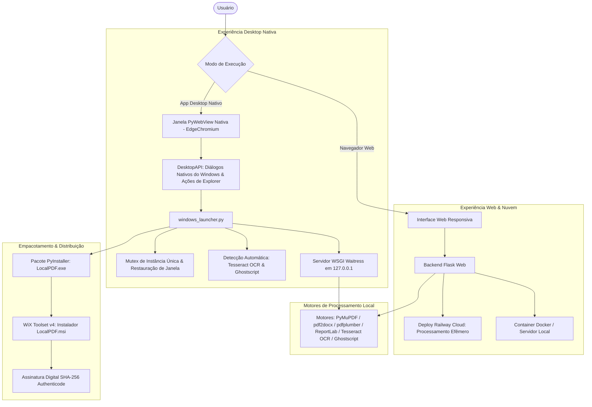

<div align="right">

🌐 **Idioma** | [English](README.md) · **Português 🇧🇷**

</div>

<div align="center">

# 🌟 LocalPDF.io

[](https://opensource.org/licenses/MIT)
[](https://www.python.org/)
[](https://flask.palletsprojects.com/)
[](https://pywebview.flowrl.com/)
[](https://www.docker.com/)
[](https://localpdf.up.railway.app/)
[](https://github.com/JoadsonRocha/localpdf.io/releases/download/1.0.0/LocalPDF.msi)
[](CONTRIBUTING.md)
[](#-contribuidores)

<br>

<a href="https://github.com/JoadsonRocha/localpdf.io/releases/download/1.0.0/LocalPDF.msi">
  
</a>

<br><br>

> Todas as ferramentas de PDF que você precisa — 100% local, 100% privado, zero rastreamento na nuvem.

**💻 [Baixar Instalador Windows (MSI)](https://github.com/JoadsonRocha/localpdf.io/releases/download/1.0.0/LocalPDF.msi)** • **🚀 [Testar Demo Web no Railway](https://localpdf.up.railway.app/)** • **🌐 [Site Oficial do Projeto](https://virgiliojr94.github.io/localpdf.io/)**

[Download](#-instalador-oficial-para-windows-msi) •
[Funcionalidades](#-funcionalidades--ux) •
[Arquitetura](#-arquitetura) •
[Como Usar](#-como-usar) •
[Roadmap](ROADMAP.md) •
[Contribuir](CONTRIBUTING.md) •
[Licença](#-licença)

</div>

---

## 📋 O que é?

LocalPDF.io é uma aplicação moderna para manipulação e conversão de documentos e arquivos PDF. Cada arquivo é processado diretamente no seu computador — nada é enviado para servidores externos ou armazenado na nuvem.

Sem necessidade de cadastro. Sem planos de assinatura. Sem limites arbitrários de páginas. Privacidade documental absoluta.

---

## ✨ Funcionalidades & UX

Todas as operações são executadas localmente com alto desempenho de hardware e limite configurável de 100 MB por upload.

### 📥 Converter para PDF
- **🖼️ Imagens → PDF** - Combine múltiplas imagens (JPG, PNG) em um único PDF organizado.
- **📝 Word → PDF** - Converta documentos DOCX para PDF com alta fidelidade visual: títulos (H1, H2), estilos tipográficos (**negrito**, *itálico*, <u>sublinhado</u>) e tabelas estruturadas com auto-ajuste e bordas (alimentado por ReportLab `SimpleDocTemplate`).
- **📊 Excel → PDF** - Transforme planilhas XLSX em tabelas PDF com largura de coluna calculada dinamicamente, suporte a fórmulas e formatação de datas.
- **📄 Texto → PDF** - Converta arquivos de texto puro (TXT) em documentos PDF limpos e prontos para impressão.

### 📤 Converter de PDF
- **🖼️ PDF → JPG** - Converta páginas PDF em imagens JPG compactadas de alta resolução.
- **🖼️ PDF → PNG** - Converta páginas PDF em imagens PNG nítidas (lossless).
- **🖼️ PDF → Imagens** - Extraia cada página individual do documento como imagem.
- **📊 PDF → Excel** - Extraia dados e tabelas do PDF diretamente para planilhas editáveis do Excel (.xlsx) (alimentado por `pdfplumber` e `openpyxl`).
- **📝 PDF → Word** - Converta arquivos PDF em documentos editáveis do Word (.docx) (alimentado por `pdf2docx`).
- **📄 PDF → Texto** - Extraia todo o conteúdo de texto nativo para arquivo TXT limpo.
- **🔒 PDF → PDF/A** - Converta documentos para conformidade com o padrão de arquivamento legal PDF/A-1b (via Ghostscript).
- **🔍 OCR em PDF** - Reconhecimento Óptico de Caracteres para digitalizações e imagens com Tesseract OCR local, com fallback inteligente para texto digital nativo quando o OCR não estiver instalado.

### 🔄 Organizar, Editar e Proteger PDF
- **🔗 Mesclar PDFs** - Una múltiplos arquivos PDF em um único documento mantendo a ordem desejada.
- **✂️ Dividir PDF** - Separe todas as páginas ou extraia intervalos personalizados (ex.: `1-3, 5, 8-10`).
- **📦 Comprimir PDF** - Reduza o peso do arquivo otimizando imagens e fluxos internos com preservação da legibilidade.
- **🔐 Proteger PDF** - Criptografe documentos PDF com senha local segura e padrão AES-256.
- **🔓 Desbloquear PDF** - Remova permanentemente senhas e restrições de edição/impressão de PDFs conhecidos.
- **💧 Marca d'Água Profissional** - Insira marcas d'água diagonais a 45° ou no cabeçalho/rodapé com controle total de texto, opacidade suave e cor.
- **🔢 Números de Página** - Adicione numeração sequencial personalizada no cabeçalho ou rodapé.
- **🖥️ Editor Visual de Páginas PDF** - Ambiente interativo em tela cheia para reordenar páginas via arrastar e soltar (drag & drop), inserir páginas de outros PDFs ou imagens, adicionar páginas em branco, girar (90°), duplicar e excluir páginas.

### 💻 Experiência Desktop Nativa no Windows
- **🪟 Janela Nativa com PyWebView**: Aplicativo executado em janela desktop própria através do Microsoft Edge Chromium (WebView2), sem barras de navegador convencionais.
- **💾 Diálogo Nativo de Salvar Arquivo**: Integração com a caixa padrão `SaveFileDialog` do Windows para escolher pastas e nomes de arquivo com filtros de extensão dedicados.
- **📂 Integração Direta com o Sistema**: Botões de ação rápida "Abrir Pasta" (`explorer.exe /select`) para destacar o arquivo salvo no Windows Explorer e "Abrir Arquivo" (`os.startfile`) no aplicativo padrão.
- **⚙️ Detecção Automática de Dependências**: Localização automática das instalações do Tesseract OCR e Ghostscript na pasta `vendor/` ou em diretórios do sistema (`%LOCALAPPDATA%`, `Program Files`), registrando DLLs e variáveis de ambiente na inicialização.
- **🛡️ Instância Única com Mutex**: Protegido por Mutex do Windows (`CreateMutexW`) e arquivo de porta ativa para restaurar e focar a janela existente caso o aplicativo seja reaberto, evitando processos duplicados.
- **🌐 Fallback Automático para Navegador**: Se o ambiente PyWebView não estiver disponível, abre automaticamente o navegador padrão do sistema em `127.0.0.1:<porta>/splash`.

### 💎 Interface Moderna & Experiência de Uso
- **🎨 Ícones SVG Customizados**: Ícones vetoriais modernos e exclusivos para cada ferramenta.
- **🏷️ Abas de Categorias em Tempo Real**: Filtragem instantânea por *Todos*, *Organizar PDF*, *Converter PDF*, *Otimizar PDF* e *OCR*.
- **📑 Rotas Diretas para Cada Ferramenta**: URLs amigáveis dedicadas (`/tool/<nome_ferramenta>`, `/editor` e `/about` / `/sobre`) com títulos sincronizados e metadados de SEO ricos.
- **⚡ Feedback Visual Dinâmico**: Barra de progresso com animação shimmer (`progressShimmer`), mensagens contextuais em tempo real das etapas de processamento e cronômetro de tempo decorrido (`⏱️ 00:03`).
- **📁 Gerenciamento de Arquivos no Upload**: Badges com formato de extensão, exibição do tamanho legível (`KB` / `MB`) e botão individual para remover arquivos (`✕ Remover`).
- **📥 Download Instantâneo sem Reprocessamento**: O card de resultado preserva o arquivo gerado em cache de memória para permitir novo download sem enviar novamente.
- **🏷️ Nomenclatura Padronizada de Arquivos**: Os arquivos gerados mantêm o nome base do documento original (ex.: `relatorio_comprimido.pdf`, `contrato_mesclado.pdf`, `financeiro.xlsx`, `documento_ocr.txt`).
- **ℹ️ Página Sobre Completa**: Aba `/about` dedicada com arquitetura detalhada de privacidade e comparativos diretos frente a serviços na nuvem.
- **🌐 Suporte Bilíngue Nativo**: Alternância imediata entre Português (pt-BR) e Inglês (EN).

---

## 🏗️ Arquitetura

O LocalPDF.io possui uma arquitetura de destino duplo: aplicativo Desktop nativo para Windows (Portátil / MSI via PyWebView) e serviço web local ou na nuvem (Docker / Railway).



### 1. Arquitetura Desktop para Windows
- **Janela Nativa**: Renderização local através do `pywebview` com motor EdgeChromium.
- **Executável Portátil**: Pacote autocontido gerado via PyInstaller (`dist/LocalPDF/LocalPDF.exe`).
- **Instalador MSI**: Pacote profissional gerado com WiX Toolset v4 (`dist/LocalPDF.msi`) para instalação por máquina em `Program Files`.
- **Isolamento Local & Segurança**:
  - Vinculado exclusivamente ao endereço de loopback `127.0.0.1` em porta dinâmica livre.
  - Bloqueio de instâncias concorrentes com Mutex (`CreateMutexW`).
  - Arquivos temporários residem em `%TEMP%`, sem gravar em diretórios protegidos do sistema.
  - Endpoints desktop exclusivos (`/api/desktop/*`) para salvar diretamente e abrir no Windows Explorer.
- **Assinatura Digital Authenticode**:
  - Scripts em `packaging/windows/` para assinar binários e o instalador com SHA256 e carimbo de tempo RFC 3161 (DigiCert).

### 2. Arquitetura Web & Nuvem
- **Backend**: Python 3.11+ com Flask 3.1.3 e Waitress WSGI.
- **Processamento Volátil Efêmero**: No modo web, arquivos enviados residem apenas na memória temporária do servidor e são excluídos definitivamente logo após o término da operação ou download.
- **Headers de Segurança**: Políticas ativas como `X-Content-Type-Options: nosniff`, `X-Frame-Options: SAMEORIGIN` e `Cache-Control: no-store`.

---

## 💻 Instalador Oficial para Windows (MSI)

Baixe a versão nativa pronta para uso no seu computador:

<div align="center">
  <br>
  <a href="https://github.com/JoadsonRocha/localpdf.io/releases/download/1.0.0/LocalPDF.msi">
    
  </a>
  <p><em>Compatível com Windows 10 e 11 (64-bit) • ~99 MB • Assinado digitalmente • Atalhos no Menu Iniciar e Desktop</em></p>
  <br>
</div>

1. Baixe o instalador [`LocalPDF.msi`](https://github.com/JoadsonRocha/localpdf.io/releases/download/1.0.0/LocalPDF.msi).
2. Dê duplo clique para instalar (instalação limpa em `C:\Program Files\LocalPDF.io`).
3. Abra pelo atalho **LocalPDF.io** no Menu Iniciar ou na Área de Trabalho.
4. O app abre em janela nativa limpa, com diálogos de salvar do Windows e desempenho 100% offline.

> 💡 **Desenvolvedores**: Veja [packaging/windows/README.md](packaging/windows/README.md) para instruções completas de compilação do executável portátil, geração do pacote MSI com WiX v4 e assinatura com Authenticode.

---

## 🚀 Como usar

### 1. Testar Online (Demonstração Web)
Experimente todas as funcionalidades diretamente no navegador:
👉 **[https://localpdf.up.railway.app/](https://localpdf.up.railway.app/)**

### 2. Com Docker (Auto-Hospedado)
Execute a imagem pronta a partir do GitHub Container Registry:

```bash
docker run -p 5000:5000 ghcr.io/virgiliojr94/localpdf.io:latest
```

Acesse: **http://localhost:5000**

### 3. Rodar a partir do Código-Fonte

```bash
# Clone o repositório
git clone https://github.com/JoadsonRocha/localpdf.io.git
cd localpdf.io

# Crie e ative o ambiente virtual Python
python -m venv .venv
.\.venv\Scripts\activate

# Instale as dependências
pip install -r requirements.txt

# Execute a aplicação
python app.py
```

Acesse: **http://localhost:5000**

---

## 🛠️ Tecnologias

- **Flask 3.1.3** - Framework web moderno em Python
- **pywebview 6.0+** - Invólucro de aplicativo desktop nativo (Edge Chromium)
- **PyMuPDF 1.23.8 (Fitz)** - Motor C++ de alto desempenho para manipulação e renderização de PDF
- **Pillow 12.1.1 (PIL)** - Manipulação e rasterização de imagens
- **pdf2docx 0.5.8** - Motor de conversão de PDF para documentos Word
- **python-docx 0.8.11** - Leitura e estruturação de documentos Word
- **pdfplumber 0.11.9** - Extração precisa de tabelas e dados tabulares de PDFs
- **ReportLab 4.0.5** - Geração dinâmica de PDFs estilizados (`SimpleDocTemplate`, `Table`, `Paragraph`)
- **OpenPyXL 3.1.2** - Criação e manipulação de planilhas Excel (.xlsx)
- **Tesseract OCR (pytesseract 0.3.10)** - Reconhecimento óptico de caracteres com fallback para texto nativo
- **Ghostscript 0.7** - Conversão e conformidade com PDF/A
- **Waitress** - Servidor WSGI de produção para execução desktop local
- **WiX Toolset v4** - Sistema de compilação de instaladores para Windows (MSI)
- **PyInstaller** - Empacotador de executáveis autônomos para Windows

---

## 🔒 Privacidade & Segurança

Todo o processamento documental ocorre estritamente **no seu próprio computador** ao utilizar o aplicativo Desktop ou o Docker auto-hospedado. Nenhum conteúdo de documento, metadado ou telemetria é enviado para servidores externos.

---

## 🤝 Contribuindo

Contribuições são muito bem-vindas! Veja o [guia de contribuição](CONTRIBUTING.md) para começar.

---

## 👥 Contribuidores

Obrigado a todas as pessoas que contribuíram para o LocalPDF.io! ✨

<a href="https://github.com/virgiliojr94/localpdf.io/graphs/contributors">
  
</a>

---

## 📝 Licença

Distribuído sob a licença MIT. Consulte o arquivo `LICENSE` para mais detalhes.
